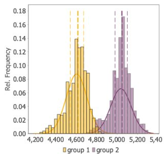
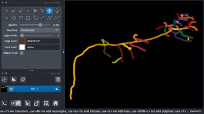
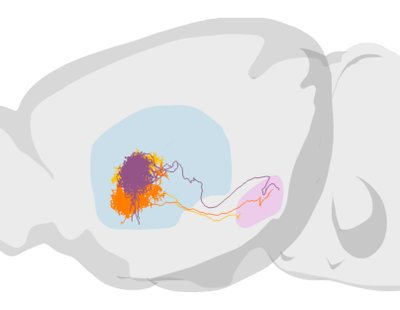
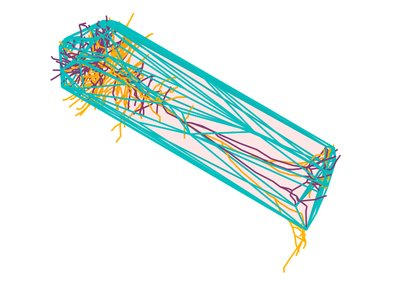
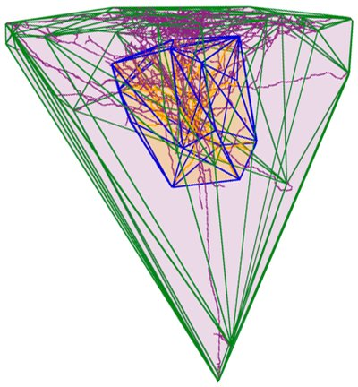
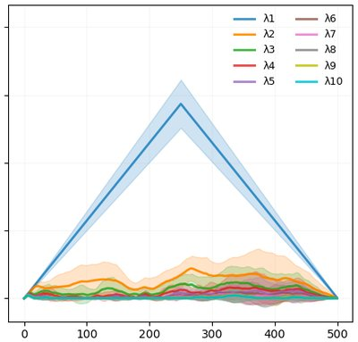
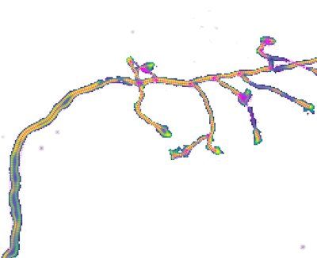
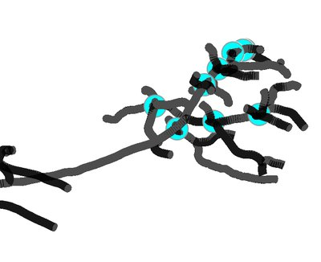
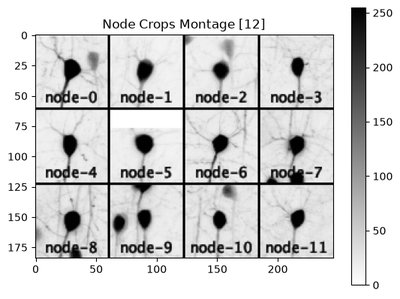

<em>Computational Neuroanatomy: A Hands-on Curriculum in Python</em> is a free, self-paced series of runnable notebooks that teaches neuroanatomy in Python using real data. The series is ordered by increasing complexity, from a single reconstruction to atlas-scale analysis and ML-ready ground truth.

<a href="https://pysnt.readthedocs.io/en/latest/notebooks/index.html"><strong>Start the curriculum</strong></a> (hosted on Read the Docs)

## At a glance

- **Audience:** neuroscientists and image analysts comfortable with basic Python. No prior SNT or Java experience is needed
- **Format:** 9 self-contained notebooks, each stating its learning objectives, estimated time, and requirements. About 4 to 5 hours in total
- **Data:** real reconstructions and volumes (e.g., MouseLight, NeuroMorpho.org, remote OME-Zarr), analyzed with SNT through [PySNT](https://github.com/morphonets/pysnt) alongside NumPy, pandas, NetworkX, napari, and scikit-learn
- **Access:** open and free, no registration. Notebooks can be read online or downloaded and run locally

## Tutorials

<a class="nb-card" href="https://pysnt.readthedocs.io/en/latest/notebooks/01_single_cell_analysis.html">T01Single Cell AnalysisBeginner20-30 min</a>
<a class="nb-card" href="https://pysnt.readthedocs.io/en/latest/notebooks/02_napari_viewer.html">T02Visualizing Reconstructions in napariBeginner10-15 min</a>
<a class="nb-card" href="https://pysnt.readthedocs.io/en/latest/notebooks/03_hemisphere_analysis.html">T03Hemisphere AnalysisBeginner30 min</a>
<a class="nb-card" href="https://pysnt.readthedocs.io/en/latest/notebooks/04_convex_hull.html">T04Volumetric QuantificationsIntermediate30-40 min</a>
<a class="nb-card" href="https://pysnt.readthedocs.io/en/latest/notebooks/05_tree_intersection.html">T05Spatial Intersection Between TreesIntermediate30-40 min</a>
<a class="nb-card" href="https://pysnt.readthedocs.io/en/latest/notebooks/06_persistence_landscape.html">T06Unsupervised Classification of Projection NeuronsIntermediate40 min</a>
<a class="nb-card" href="https://pysnt.readthedocs.io/en/latest/notebooks/07_curvature_optimization.html">T07Curvature Optimization with Automated Path TracingAdvanced45 min</a>
<a class="nb-card" href="https://pysnt.readthedocs.io/en/latest/notebooks/08_crossover_detection.html">T08Crossover DetectionAdvanced15-20 min</a>
<a class="nb-card" href="https://pysnt.readthedocs.io/en/latest/notebooks/09_big_data.html">T09Handling Large-Scale Neuronal DataAdvanced30 min</a>

## Source, license, and feedback

The source of every notebook is on [GitHub](https://github.com/morphonets/pysnt/tree/main/docs/notebooks). Text and figures are licensed under [CC BY 4.0](https://creativecommons.org/licenses/by/4.0/), code under the PySNT [license](https://github.com/morphonets/pysnt/blob/main/LICENSE.md), and datasets are subject to their original terms. Corrections, new tutorials, and feedback are welcome on the [forum](https://forum.image.sc/tag/snt) or as [issues](https://github.com/morphonets/pysnt/issues).

## Citing

> Ferreira TA, PySNT and SNT contributors. *Computational Neuroanatomy: A Hands-on Curriculum in Python*. [morphonets.org/computational-neuroanatomy](https://morphonets.org/computational-neuroanatomy/), [doi:10.5281/zenodo.24090107](https://doi.org/10.5281/zenodo.24090107)

See also the [SNT citation guidelines](https://imagej.net/plugins/snt/faq#how-do-i-cite-snt).
