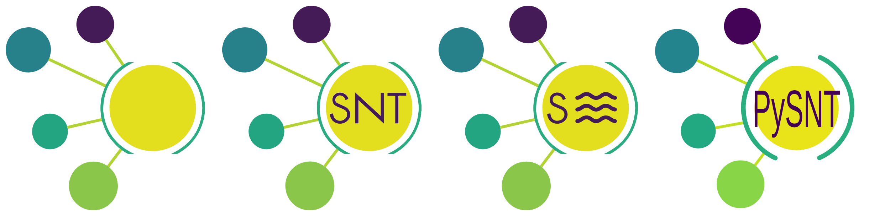

<h1 align="center">Welcome To Morphonets!</h1>

Morphonets is an open, community-driven effort to provide tools for tracing, visualization, quantification, and modeling of neuroanatomical data, from [Fiji](https://fiji.sc)/[ImageJ](https://imagej.net) to [Python](https://github.com/morphonets/pysnt) and [napari](https://napari.org). Our tools stand on the shoulders of [SciJava](https://scijava.org) and its Python sibling [scyjava](https://github.com/scijava/scyjava).
Our immediate focus is cellular neuroscience, but the software we develop has been successfully applied to other areas of the biosciences.

## Projects
Morphonets has incorporated several projects that were previously scattered across the Fiji ecosystem of plugins. Currently, the following major projects are being developed under the Morphonets umbrella:

SNTFiji

The open-source framework for quantification of neuronal anatomy: semi- and fully automated tracing, proofreading, 2D, 3D and large-volume visualization, morphometry, Sholl and other comparative analyses, and graph analysis.

<a href="https://imagej.net/plugins/snt/">Documentation</a><a href="https://rdcu.be/c9LJe">Publication</a><a href="https://github.com/morphonets/SNT">GitHub</a>

SNT StreamFiji

The big data cousin of SNT: tracing and analysis of terabyte-scale volumes, including remote OME-Zarr and N5 datasets, with interactive 3D visualization powered by BigDataViewer and BigVolumeViewer.

<a href="https://imagej.net/plugins/snt/snt-stream">Documentation</a>

PySNTPython

A Python wrapper for SNT that brings its tracing and analysis capabilities to Jupyter notebooks and NumPy/pandas-based pipelines, without a separate Fiji workflow.

<a href="https://pysnt.readthedocs.io">Documentation</a><a href="/computational-neuroanatomy/">Curriculum</a><a href="https://pypi.org/project/pysnt/">PyPI</a><a href="https://github.com/morphonets/pysnt">GitHub</a>

napari-sntnapari

A napari plugin that bridges napari and SNT: it sends polylines drawn in napari to SNT and receives SNT reconstructions back as napari layers.

<a href="https://github.com/morphonets/napari-snt">GitHub</a>

Sciview-Cx3DModeling

An image-based modeling framework for neurodevelopment simulations powered by Cx3D and sciview.

<a href="https://imagej.net/plugins/snt/modeling">Documentation</a><a href="https://github.com/morphonets/cx3d">GitHub</a>

Sholl AnalysisFiji

Sholl analysis directly from images, with no tracing required, or from reconstructions. Originally a stand-alone project, now incorporated into SNT.

<a href="https://imagej.net/plugins/snt/sholl">Documentation</a><a href="https://rdcu.be/c9LI8">Publication</a>

## Learning Resources

Computational NeuroanatomyPython

A self-paced series of runnable notebooks that teaches neuroanatomy in Python using real data, from a single reconstruction to atlas-scale analysis and ML-ready ground truth. Assumes basic Python only.

<a href="/computational-neuroanatomy/">Start the curriculum</a>

Script TemplatesFiji

More than 70 ready-to-run scripts in Groovy and Python covering analysis, batch processing, tracing, rendering, and big data. Open them from the Script Editor (Templates &gt; Neuroanatomy) and adapt them to your data.

<a href="https://imagej.net/plugins/snt/scripting">Documentation</a>

Screencast TutorialsVideo

Video tutorials for getting started with SNT and its main workflows.

<a href="https://imagej.net/plugins/snt/screencasts">Screencasts</a>

Image.sc ForumCommunity

Questions, tips, and discussions about SNT from users and developers.

<a href="https://forum.image.sc/tag/snt/">Forum posts</a>

## Getting Involved
[Anyone can contribute](https://imagej.net/plugins/snt/contribute)! Contact us on [GitHub](https://github.com/morphonets) or the [Image.sc Forum](https://forum.image.sc/)
